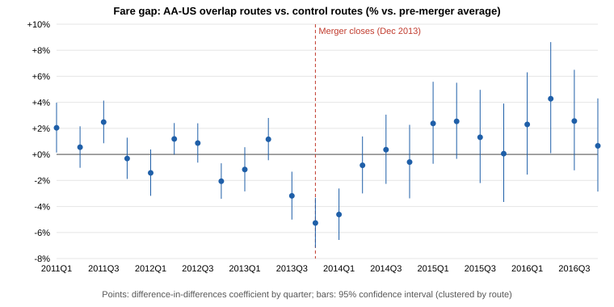

# Did the American Airlines–US Airways Merger Raise Fares?

A difference-in-differences retrospective of the 2013 American Airlines–US Airways merger, using U.S. Department of Transportation fare data for 4,006 domestic routes from 2011 to 2016. The Justice Department sued to block this merger in August 2013 and settled in November 2013 for slot and gate divestitures.

**Run:** `pip install -r requirements.txt`, then `python3 merger_analysis.py`. It downloads the DOT data on first run (about 28 MB) and writes `output/merger_report.md`, an event-study chart and CSV files.

## Approach

| Step | Method |
|---|---|
| Data | DOT Consumer Airfare Report, Table 6: quarterly average fare, passengers, distance, and the largest and lowest-fare carrier for every contiguous-U.S. city pair with 10+ passengers a day |
| Panel | 4,006 routes observed in all 24 quarters from 2011Q1 to 2016Q4 |
| Treated routes | 86 routes where AA and US were the largest and the lowest-fare carrier (in either order) in at least 2 of 11 pre-merger quarters |
| Control routes | 1,272 routes where neither AA nor US was the largest or lowest-fare carrier before the merger |
| Model | log(fare) on Overlap × Post, with route and quarter fixed effects; standard errors clustered by route |
| Robustness | Event study, linear pre-trend test, placebo merger date, distance band × quarter fixed effects, alternative treatment and control definitions, nearest-neighbor matched controls, effects by phase and by distance, and a passengers outcome |
| Validation | 11 automated checks, including a brute-force dummy-variable regression that reproduces the fixed-effects estimate and the clustered standard error |

## Findings

- **No significant average effect:** across 2014–2016, overlap-route fares rose **+0.8%** relative to controls (95% CI −1.9% to +3.6%).
- **A pre-existing trend:** before the merger, overlap-route fares were already falling relative to controls, by −0.33% a quarter (p = 0.04). That violates the simple model's parallel-trends assumption.
- **Trend-adjusted:** when overlap routes get their own trend, fares were flat in 2014 and **+4.6% higher in 2015–2016** (95% CI +1.2% to +8.2%, p = 0.008), after the airlines began operating as one carrier.
- **Long routes:** the increase is concentrated on routes of 1,000+ miles (+3.6%, p = 0.03). Traffic on overlap routes rose 4.3%.
- **Around the deal:** fares dipped about 5% in 2013Q4–2014Q1. That is consistent with the DOJ settlement period and the divestitures to low-cost carriers.
- **Conclusion:** the evidence of a price effect is **suggestive but not robust**. The matched-control estimate for 2015–2016 is +2.5% and not significant.

## Limitations

- The DOT table names only the largest and the lowest-fare carrier on each route, so head-to-head overlap is a proxy.
- Fares are nominal market averages across all carriers. Quarter fixed effects absorb common inflation and fuel costs.
- This is an academic exercise, not a legal or expert opinion.

Data: U.S. Department of Transportation, [Consumer Airfare Report Table 6](https://data.transportation.gov/d/yj5y-b2ir) (public domain).
