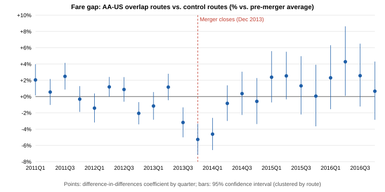

# Did the American Airlines - US Airways Merger Raise Fares?

Difference-in-differences retrospective using U.S. DOT Consumer Airfare Report data, 2011Q1-2016Q4 | 4,006 routes in a balanced panel

## Headline result

- **Average effect:** across all post-merger quarters, fares on the **86 routes** where American and US Airways competed head-to-head rose **+0.8%** relative to **1272 control routes** (95% CI -1.9% to +3.6%; p = 0.55). This is **not statistically significant**.

- **Pre-existing trend:** before the merger, overlap-route fares were already falling relative to controls by -0.33% a quarter (p = 0.039), which violates the parallel-trends assumption of the simple model.

- **Trend-adjusted effect:** allowing overlap routes their own trend, fares were unchanged in 2014 (-0.0%) and rose **+4.6% in 2015-2016** (95% CI +1.2% to +8.2%; p = 0.008), after the airlines began operating as one carrier.

- **Where:** the increase is concentrated on routes of 1,000+ miles (+3.6%, p = 0.025); traffic on overlap routes rose +4.3%.

- **Conclusion:** the evidence of a merger price effect is **suggestive but not robust**: it depends on how the pre-existing trend and the control group are specified. Taking the trend-adjusted 2015-2016 estimate at face value implies about **$114,476,892 a year** in higher fares on these routes.

## Regression results (outcome: log average fare unless noted)

| Specification | Effect | 95% CI | p-value | Treated | Control | Obs. |
|---|---|---|---|---|---|---|
| Main: overlap vs. control, route + quarter FE | +0.8% | -1.9% to +3.6% | 0.547 | 86 | 1272 | 31,234 |
| Distance band x quarter FE | +2.3% | -0.5% to +5.1% | 0.105 | 86 | 1272 | 31,234 |
| Overlap in >=1 pre quarter | +0.3% | -1.8% to +2.4% | 0.784 | 146 | 1272 | 32,614 |
| Overlap in >=3 pre quarters | -0.4% | -3.7% to +3.0% | 0.827 | 61 | 1272 | 30,659 |
| Control = routes with only one of AA/US | +1.0% | -1.7% to +3.7% | 0.478 | 86 | 2588 | 61,502 |
| Including merger quarter 2013Q4 as post | +1.3% | -1.3% to +4.0% | 0.340 | 86 | 1272 | 32,592 |
| Placebo: fake merger in 2012Q3 (pre-period only) | -1.6% | -3.5% to +0.2% | 0.089 | 86 | 1272 | 14,938 |
| Outcome: log passengers | +4.3% | +0.2% to +8.7% | 0.040 | 86 | 1272 | 31,234 |
| Routes under 1,000 miles | -2.1% | -7.3% to +3.4% | 0.439 | 27 | 709 | 16,928 |
| Routes 1,000+ miles | +3.6% | +0.5% to +6.8% | 0.025 | 59 | 563 | 14,306 |
| Phase: 2014 (integration year) | -1.4% | -3.5% to +0.6% | 0.173 | 86 | 1272 | 31,234 |
| Phase: 2015-2016 (after single operating certificate) | +2.0% | -1.3% to +5.4% | 0.234 | 86 | 1272 | 31,234 |
| Trend-adjusted: 2014 | -0.0% | -2.1% to +2.1% | 0.974 | 86 | 1272 | 31,234 |
| Trend-adjusted: 2015-2016 | +4.6% | +1.2% to +8.2% | 0.008 | 86 | 1272 | 31,234 |
| Matched controls (5 nearest neighbors) | +1.3% | -1.6% to +4.4% | 0.376 | 86 | 283 | 8,487 |
| Matched controls: 2015-2016 | +2.5% | -1.0% to +6.2% | 0.160 | 86 | 283 | 8,487 |

## Event study

Joint test that the overlap-control gap was constant across all pre-merger quarters: F = 7.13, p = 0.000. Linear pre-trend: -0.33% per quarter (p = 0.039).

| Quarter | Gap vs. pre-merger average | 95% CI |
|---|---|---|
| 2011Q1 | +2.0% | +0.1% to +4.0% |
| 2011Q2 | +0.6% | -1.0% to +2.2% |
| 2011Q3 | +2.5% | +0.9% to +4.1% |
| 2011Q4 | -0.3% | -1.9% to +1.3% |
| 2012Q1 | -1.4% | -3.2% to +0.4% |
| 2012Q2 | +1.2% | -0.0% to +2.4% |
| 2012Q3 | +0.9% | -0.6% to +2.4% |
| 2012Q4 | -2.1% | -3.4% to -0.7% |
| 2013Q1 | -1.2% | -2.8% to +0.6% |
| 2013Q2 | +1.2% | -0.4% to +2.8% |
| 2013Q3 | -3.2% | -5.0% to -1.3% |
| 2013Q4 | -5.3% | -7.2% to -3.3% |
| 2014Q1 | -4.6% | -6.6% to -2.6% |
| 2014Q2 | -0.8% | -3.0% to +1.4% |
| 2014Q3 | +0.4% | -2.3% to +3.1% |
| 2014Q4 | -0.6% | -3.4% to +2.3% |
| 2015Q1 | +2.4% | -0.7% to +5.6% |
| 2015Q2 | +2.5% | -0.3% to +5.5% |
| 2015Q3 | +1.3% | -2.2% to +5.0% |
| 2015Q4 | +0.1% | -3.7% to +3.9% |
| 2016Q1 | +2.3% | -1.5% to +6.3% |
| 2016Q2 | +4.3% | +0.1% to +8.6% |
| 2016Q3 | +2.6% | -1.2% to +6.5% |
| 2016Q4 | +0.7% | -2.9% to +4.3% |

## Pre-merger route characteristics (2011Q1-2013Q3 averages)

| Group | Routes | Distance (mi) | Passengers/day | Avg fare |
|---|---|---|---|---|
| Overlap | 86 | 1,416 | 235 | $271 |
| Control | 1272 | 1,038 | 406 | $226 |
| Matched controls | 283 | 1,350 | 235 | $264 |

## Largest overlap routes by traffic

| Route | Pre-merger fare | Post-merger fare | Change |
|---|---|---|---|
| Dallas/Fort Worth, TX - New York City, NY (Metropolitan Area) | $343 | $252 | -26.5% |
| Boston, MA (Metropolitan Area) - Dallas/Fort Worth, TX | $272 | $220 | -19.1% |
| Dallas/Fort Worth, TX - Phoenix, AZ | $219 | $185 | -15.7% |
| Nashville, TN - New York City, NY (Metropolitan Area) | $232 | $205 | -11.7% |
| Dallas/Fort Worth, TX - Philadelphia, PA | $255 | $234 | -8.1% |
| Charlotte, NC - Chicago, IL | $241 | $209 | -13.5% |
| Charlotte, NC - Los Angeles, CA (Metropolitan Area) | $312 | $342 | +9.6% |
| Charlotte, NC - Dallas/Fort Worth, TX | $292 | $276 | -5.4% |
| Charlotte, NC - San Francisco, CA (Metropolitan Area) | $342 | $358 | +4.5% |
| Dallas/Fort Worth, TX - Raleigh/Durham, NC | $259 | $257 | -0.9% |

## Validation checks

| Check | Result | Detail |
|---|---|---|
| No duplicate route-quarters | PASS | 178,704 rows |
| Balanced panel (every route in every quarter) | PASS | 4,006 routes x 24 quarters |
| Treated and control groups are disjoint | PASS | 86 vs 1272 routes |
| No missing or non-positive fares | PASS | all fares > 0 |
| TWFE estimate equals 2x2 difference-in-differences of means | PASS | 0.008398 vs 0.008398 |
| Within estimator matches brute-force dummy-variable OLS (100-route subsample) | PASS | 0.00026385 vs 0.00026385 |
| Residuals match between within and dummy-variable OLS | PASS | max diff 4.9e-14 |
| Clustered standard error matches dummy-variable computation | PASS | 0.030081 vs 0.030081 |
| Merging carrier US disappears from data after integration | PASS | US Airways code absent from 2015Q3 on |
| Event-study pre-merger effects average to zero | PASS | re-centered on pre-period mean |
| Matched controls are balanced on distance, traffic and fare (within 10%) | PASS | miles -4.7%, pax -0.2%, fare -2.8% |

## Limitations

- The DOT table names only the largest and the lowest-fare carrier on each route, so head-to-head overlap is measured with a proxy; routes where AA and US were both present but neither was largest or cheapest are not identified.
- The 2015-2016 effect relies on extrapolating the overlap routes' pre-merger trend; the simple and matched-control estimates for that period are smaller and not significant.
- Fares are market averages across carriers and are nominal; quarter fixed effects absorb common inflation and fuel-cost changes.
- Control routes differ in size and distance from overlap routes; the distance-band x quarter specification and the event study address this, but do not rule out every route-specific shock (for example, other carriers' entry).
- This is a retrospective academic exercise, not a legal or expert opinion.
